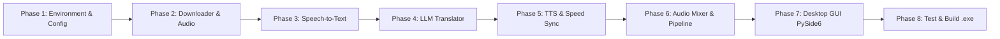

# Detailed Implementation Plan & Phase Checklists: AutoSub Dubbing Studio

An end-to-end development roadmap and phase-by-phase checklist for AutoSub Dubbing Studio, featuring automated video downloads, Speech-to-Text transcription, LLM translation, AI voice dubbing, and a PySide6 Desktop Studio interface.

> For the follow-up reliability work identified in the pipeline review, see [Video Pipeline Reliability and Completion Plan](reliability_improvement_plan.md).

---

## 📋 Roadmap & Phase Checklists

---

### Phase 1: Environment & Foundational Configuration
- [x] Create project dependencies file `requirements.txt`
- [x] Create sample environment configuration `.env.example`
- [x] Create centralized configuration manager `config.py` with automatic directory creation (`temp/`, `output/`)
- [x] Integrate and configure pre-bundled portable FFmpeg binary in `bin/ffmpeg.exe`
- [x] Install base Python dependencies (`pip install -r requirements.txt`)

---

### Phase 2: Video Downloader & Audio Extraction Module
*Objective: Download watermark-free videos from TikTok/Douyin and extract 16kHz mono WAV audio.*
- [x] Create core package initialization `core/__init__.py`
- [x] Implement `core/downloader.py`:
  - Support high-quality video downloads via `yt-dlp`.
  - Handle local video files and network URLs seamlessly.
  - Implement download progress callback hooks.
- [x] Implement `core/audio_extractor.py`:
  - Extract audio into standardized 16kHz mono WAV format for Whisper.
  - Automatically detect portable FFmpeg binary in `bin/ffmpeg.exe`.
- [x] **Verification**: Unit tests in `tests/test_phase2.py` (PASSED).

---

### Phase 3: Speech-to-Text (STT) Module
*Objective: Transcribe dialogues and extract precise start/end timestamps using faster-whisper.*
- [x] Implement `core/transcriber.py`:
  - Initialize `faster-whisper` with CPU INT8 quantization (`compute_type="int8"`).
  - Implement in-memory model caching to prevent redundant model reloads.
  - Support word-level timestamps (`word_timestamps=True`) for animated subtitles.
  - Integrated Voice Activity Detection (VAD) filter to eliminate silence.
- [x] **Verification**: Unit tests in `tests/test_phase3.py` (PASSED).

---

### Phase 4: Contextual LLM Translation Module
*Objective: Translate dialogues with colloquial phrasing and syllable constraints suitable for video pacing.*
- [x] Implement `core/translator.py`:
  - Connect to OpenAI-compatible endpoints (`LLM_BASE_URL` & `LLM_MODEL`).
  - Specially designed system prompt for video dubbing: concise sentence length, natural social media style, and strict JSON formatting.
  - Robust JSON parser with fallback mechanism.
- [x] **Verification**: Unit tests in `tests/test_phase4.py` (PASSED).

---

### Phase 5: AI Voice Dubbing & Speed Synchronization Module
*Objective: Synthesize natural voices with edge-tts and dynamically align speech tempo using FFmpeg atempo.*
- [x] Implement `core/tts_engine.py`:
  - Asynchronous voice generation via `edge-tts` (NamMinh and HoaiMy neural voices).
  - High-precision audio duration probe (`get_audio_duration`).
  - Dynamic tempo alignment filter `atempo` clamped between `0.85x` and `1.30x` to preserve pitch.
  - Batch segment processing function `process_dubbing_segments`.
- [x] **Verification**: Unit tests in `tests/test_phase5.py` (PASSED, live speech synthesis verified).

---

### Phase 6: Audio Mixing & Video Packaging (Audio Mixer & Pipeline)
*Objective: Smart Audio Ducking (10% background volume, 100% dubbing audio) and video rendering.*
- [x] Implement `core/audio_mixer.py`:
  - Generate TikTok-style `.ass` subtitle files (`TikTokStyle`: bold font, black outline, bottom-center alignment).
  - Audio Ducking: lowers original audio volume and overlays dubbed segments at precise millisecond positions using `pydub`.
  - Final video rendering with FFmpeg (`-c:v libx264` with subtitles, or fast `-c:v copy`).
- [x] Implement `pipeline.py`:
  - Full end-to-end orchestrator connecting all 6 steps.
  - Command Line Interface (CLI) support.
- [x] **Verification**: Unit tests in `tests/test_phase6.py` (PASSED).

---

### Phase 7: PySide6 Native Desktop Studio Interface
*Objective: Build a native Windows desktop GUI matching the AutoDub Studio design.*
- [x] Implement `gui.py` using PySide6:
  - Tab Widget: Video Dubbing, Subtitle Translation, Model Manager.
  - Batch Video Queue (`QTableWidget`) with toolbar (+ Paste Links, + Add Videos, Remove Selected).
  - Two-column configuration grid (Original Subtitles, LLM Translation, Dubbing, Export settings).
  - Control bar: Start, Stop, Open Result Folder, smooth green `QProgressBar`.
  - Real-time dark terminal console log viewer (`QTextEdit`).
  - Multithreaded `DubbingWorker(QThread)` ensuring a responsive, freeze-free UI.
- [x] **Verification**: Unit tests in `tests/test_phase7.py` (PASSED).

---

### Phase 8: Comprehensive Testing & Standalone Executable (.exe)
- [x] Automated test runner executing all test modules: `tests/run_all_tests.py` (7/7 modules passed; optional network checks skipped when unavailable).
- [x] Standalone Windows executable packager: `build_exe.py` (PyInstaller script bundling portable FFmpeg).
- [x] 1-Click launcher script for Windows: `run_gui.bat`.
- [x] Documentation and internationalization to English for global distribution.
